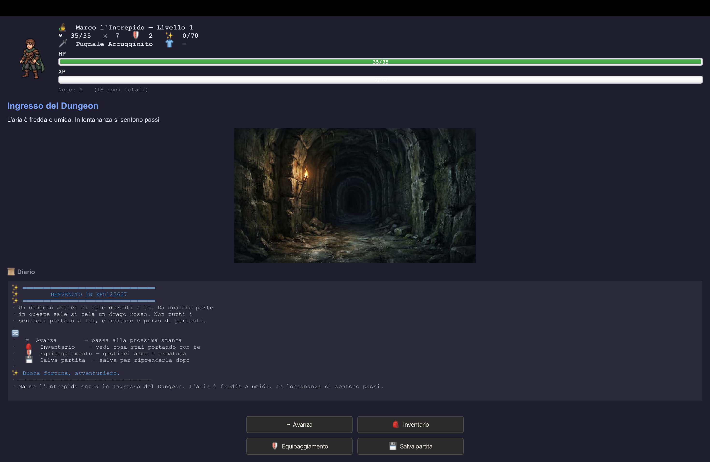
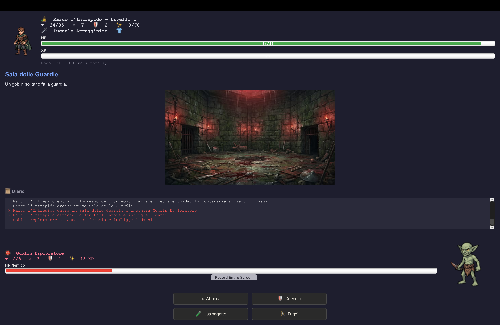
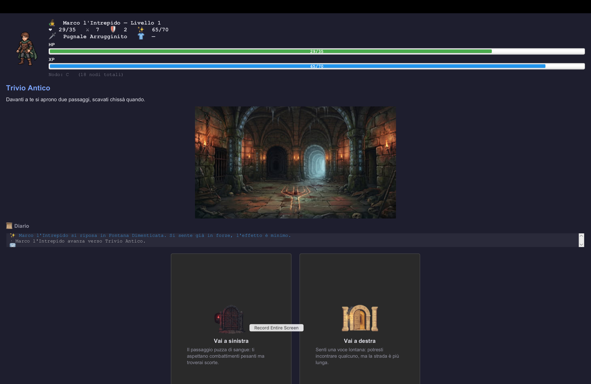
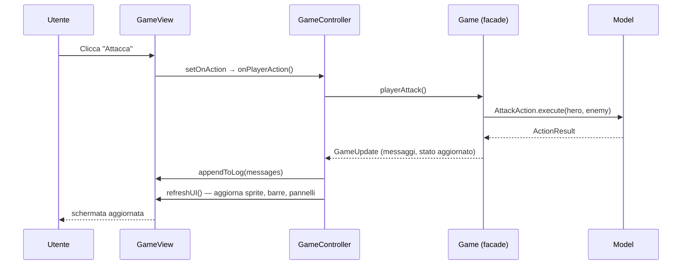
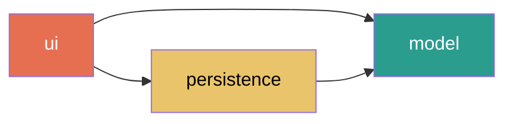
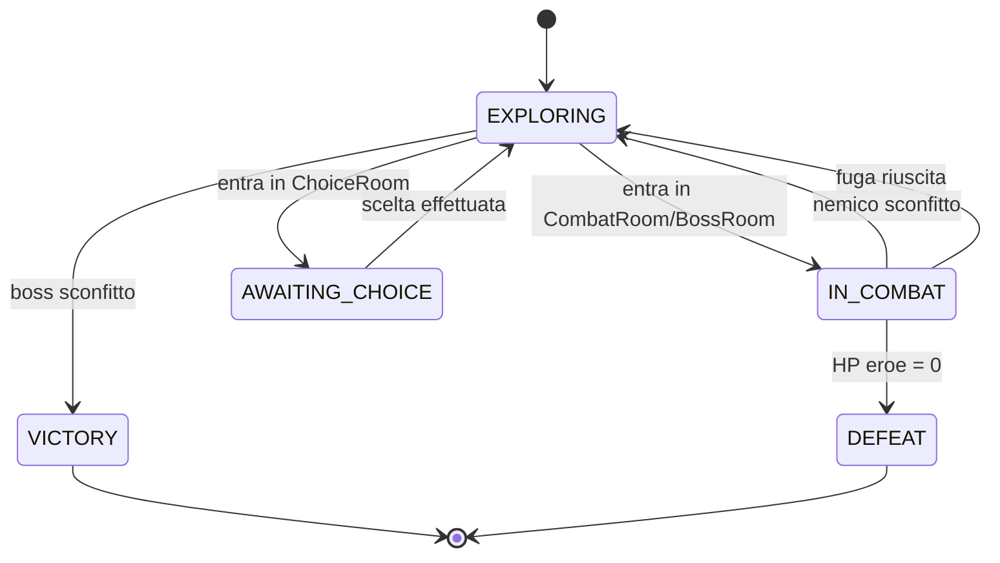
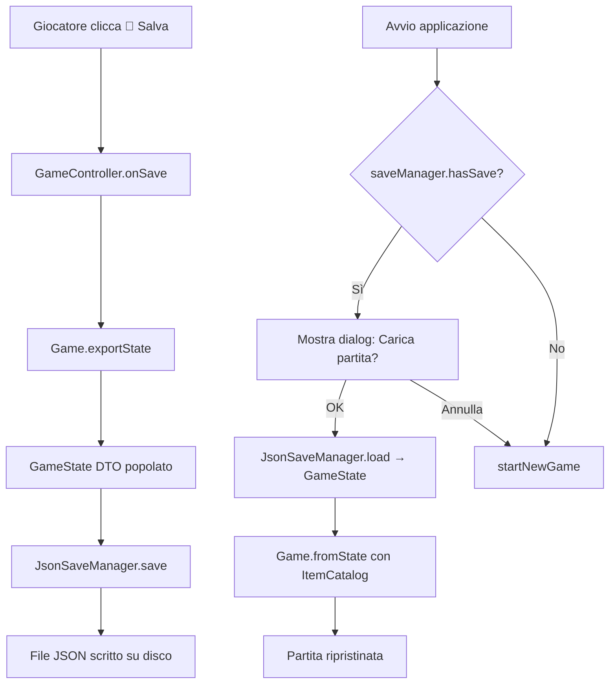

# A CASA DEL DRAGO🐉
> *Non è una visita di cortesia.*

---

## 📑 Indice

1. [Descrizione del Progetto](#1-descrizione-del-progetto)
2. [Come Giocarlo & Come Avviarlo](#2-come-giocarlo--come-avviarlo)
3. [Funzionalità Implementate](#3-funzionalità-implementate)
4. [Architettura e Organizzazione del Codice](#4-architettura-e-organizzazione-del-codice)
5. [Classi e Interfacce Principali](#5-classi-e-interfacce-principali)
6. [Pattern di Progettazione Applicati](#6-pattern-di-progettazione-applicati)
7. [Principi SOLID Applicati](#7-principi-solid-applicati)
8. [Persistenza dei Dati](#8-persistenza-dei-dati)
9. [Interfaccia Grafica (JavaFX)](#9-interfaccia-grafica-javafx)
10. [Test e Qualità](#10-test-e-qualità)
11. [Estendibilità e Integrazione Futura](#11-estendibilità-e-integrazione-futura)
12. [Dichiarazione di Uso dell'IA](#12-dichiarazione-di-uso-dellia)
13. [Credits e Risorse](#13-credits-e-risorse)

---

## 1. Descrizione del Progetto

**A casa del Drago** è un dungeon crawler a turni con interfaccia grafica, sviluppato come progetto d'esame per il corso di *Modellazione e Gestione della Conoscenza / Metodologie di Programmazione* presso UNICAM. Il giocatore impersona Marco l'Intrepido, un avventuriero che si fa strada attraverso un sotterraneo composto da stanze di tipo diverso — combattimenti, bivi, tesori, incontri con NPC, punti di riposo — con l'obiettivo di raggiungere l'antro finale e sconfiggere il **Drago Rosso Antico**.

Il dungeon è modellato come un grafo aciclico diretto (DAG) in cui alcune stanze presentano un bivio: la scelta della porta porta a rami distinti con nemici e tesori differenti, e in alcuni casi uno dei due rami è un vicolo cieco. I rami convergono poi nell'antro finale, dove si consuma lo scontro conclusivo.

**Contesto accademico**

- **Corso**: Modellazione e Gestione della Conoscenza / Metodologie di Programmazione
- **Docente**: Prof. Fabrizio Fornari
- **Anno Accademico**: 2025/2026
- **Ateneo**: Università degli Studi di Camerino (UNICAM), CdL Informatica L-31
- **Autore**: Marco Dignani — Matricola 122627
- **Repository**: https://github.com/DignaniMarco/rpg122627

**Perché questo progetto**

La scelta del dungeon crawler a turni è stata guidata da due considerazioni. La prima è pragmatica: non avendo ancora una dimestichezza particolarmente approfondita con lo sviluppo di applicazioni complesse, ho preferito evitare di partire con un genere troppo ambizioso (real-time, open world, grafica avanzata) e perdermi nei dettagli tecnici invece di concentrarmi sui concetti del corso. Il formato a turni, con stanze discrete e logica deterministica, mi ha permesso di tenere il controllo sulla complessità del codice senza sacrificare la ricchezza del dominio.

La seconda è che il dungeon crawler era il genere che si sposava meglio con l'idea di gioco che avevo in mente: un'avventura breve ma significativa, un percorso in cui ogni scelta ha un peso, un boss finale da affrontare con quello che si è raccolto lungo la via. Questo tipo di dominio mi ha offerto occasioni concrete per esercitarmi sui concetti centrali del corso — polimorfismo (tipi di stanza, nemico, oggetto), pattern di progettazione (Facade, State machine, DTO, Registry), modeling di un DAG, persistenza su file, interfaccia grafica JavaFX — mantenendo però la base del gioco a una dimensione governabile da un singolo studente.

**Requisiti del docente soddisfatti**

- ✅ Package `it.unicam.cs.mpgc.rpg122627`
- ✅ Repository GitHub pubblico
- ✅ Build Gradle: `./gradlew build`, `./gradlew run`
- ✅ Interfaccia Grafica (JavaFX)
- ✅ Persistenza dei dati (JSON, Jackson)
- ✅ Progettazione aperta all'estensione (desktop → mobile/web, nuovi tipi di stanza, nuovi `SaveManager`)
- ✅ Rispetto dei principi SOLID
- ✅ Test automatici (JUnit 5, oltre 95 test)
- ✅ README + Wiki + dichiarazione di uso dell'IA

---
## 2. Come Giocarlo & Come Avviarlo

### Prerequisiti

- **Java 21 (Temurin JDK)** — scaricabile da [adoptium.net](https://adoptium.net/temurin/releases/?version=21&package=jdk)
- **Git** — pre-installato su macOS; su Windows disponibile da [git-scm.com](https://git-scm.com/)

Verifica che Java sia correttamente installato:

```bash
java -version
```

L'output deve mostrare `openjdk 21.x`.

### Clone & Avvio

**macOS / Linux (Terminale)**

```bash
git clone https://github.com/DignaniMarco/rpg122627.git
cd rpg122627
./gradlew run
```

**Windows (PowerShell)**

```powershell
git clone https://github.com/DignaniMarco/rpg122627.git
cd rpg122627
.\gradlew.bat run
```

**IntelliJ IDEA**

1. *File → New → Project from Version Control...*
2. Incolla l'URL del repository: `https://github.com/DignaniMarco/rpg122627.git`
3. IntelliJ importa automaticamente il progetto Gradle (al primo import può servire qualche minuto per scaricare le dipendenze)
4. Apri la Gradle Tool Window (lato destro) → `rpg122627` → *Tasks* → *application* → doppio click su `run`

Al primo avvio Gradle scarica le dipendenze (JavaFX, Jackson, JUnit); dall'avvio successivo il gioco parte in pochi secondi.

### Comandi di gioco



Il giocatore impersona **Marco l'Intrepido** ed esplora il dungeon una stanza alla volta. Durante l'**esplorazione** sono disponibili i seguenti comandi:

| Comando | Effetto |
|---|---|
| ➡  **Avanza** | Entra nella stanza successiva |
| 🎒  **Inventario** | Visualizza gli oggetti raccolti |
| 🛡  **Equipaggiamento** | Gestisce arma e armatura equipaggiate |
| 💾  **Salva partita** | Salva lo stato corrente su file JSON |

Nelle stanze di **combattimento** i comandi cambiano:



| Comando | Effetto |
|---|---|
| ⚔  **Attacca** | Infligge danno pari ad attacco base + bonus arma, mitigato dalla difesa nemica |
| 🛡  **Difenditi** | Riduce il danno del prossimo colpo nemico |
| 🧪  **Usa oggetto** | Consuma una pozione dall'inventario (es. recupero HP) |
| 🏃  **Fuggi** | Tenta la fuga dal combattimento (riesce con probabilità variabile) |

Nei **bivi** vengono proposte due porte, ciascuna con un'etichetta descrittiva. Scegliere una porta porta a un ramo distinto del dungeon:



I due rami del dungeon convergono poi nell'**antro finale**, dove si consuma lo scontro con il boss. Durante la partita il salvataggio viene cancellato automaticamente in caso di vittoria o sconfitta, in modo che la partita successiva ricominci da zero.

### Obiettivo

Sconfiggere il **Drago Rosso Antico** 🐲 nell'antro finale. In bocca al lupo.

---

## 3. Funzionalità Implementate

### Gameplay principale

*A casa del Drago* è un dungeon crawler a turni single-player. Il giocatore (Marco l'Intrepido) parte dall'ingresso del dungeon e procede stanza per stanza fino al boss finale. Il flusso di gioco si articola in tre fasi che si alternano in base al tipo di stanza corrente:

- **Esplorazione** — nelle stanze non ostili (ingresso, bivi, tesori, NPC, riposo) il giocatore legge il diario di gioco e sceglie quando avanzare. In qualunque momento durante l'esplorazione sono disponibili i pannelli Inventario, Equipaggiamento e il salvataggio manuale.
- **Combattimento a turni** — nelle stanze di combattimento inizia uno scontro a turni classico. Il giocatore agisce prima (attacco, difesa, uso oggetto, fuga), il nemico contrattacca automaticamente. La fase continua finché uno dei due combattenti non va in HP 0 o il giocatore riesce a fuggire.
- **Scelta** — nei bivi, il giocatore è chiamato a scegliere tra due porte distinte. Ogni porta porta a un ramo diverso del dungeon con nemici, tesori e stanze diverse.

### Sistema di combattimento

Il combattimento è deterministico sulla componente di base ma incorpora casualità controllata su alcuni aspetti:

- **Attacco** — il danno inflitto è pari a `(attacco_base + bonus_arma) − difesa_bersaglio`, con minimo 0. Il colpo non manca mai, ma un bersaglio molto corazzato può ridurlo a zero.
- **Difesa** — raddoppia (temporaneamente) la difesa del personaggio per il prossimo turno nemico, utile per attutire un colpo pesante.
- **Fuga** — tentativo con probabilità del 50% fissa. In caso di fallimento il nemico ottiene un turno gratis.
- **Uso oggetto** — consuma una pozione dall'inventario; l'uso conta come turno del giocatore.
- **Vittoria** — alla sconfitta del nemico il giocatore ottiene punti esperienza. Al raggiungimento della soglia il livello sale, con bonus su HP massimi, attacco base e difesa base.
- **Sconfitta** — se gli HP del giocatore scendono a 0 la partita termina e il salvataggio viene cancellato automaticamente.

### Inventario & Equipaggiamento

Il giocatore dispone di un **inventario con capienza limitata** (20 slot) in cui vengono depositati tutti gli oggetti raccolti nel dungeon. Gli oggetti sono di tre categorie:

- **Consumabili** — pozioni di diversa potenza (Pozione Minore, Media, Rossa, Maggiore). In combattimento ripristinano HP in base alla potenza.
- **Armi (`Weapon`)** — aumentano l'attacco del personaggio di un `attackBonus`. Attualmente il catalogo include *Pugnale Arrugginito* e *Spada d'Argento*; il sistema è aperto all'aggiunta di nuove armi.
- **Armature (`Armor`)** — aumentano la difesa del personaggio di un `defenseBonus`. Analoghe alle armi.

Il pannello **Equipaggiamento** permette di indossare al massimo **un'arma e un'armatura** alla volta scelte dall'inventario. Nelle stanze del tesoro il gioco equipaggia **automaticamente** l'oggetto trovato se superiore a quello attuale, in modo da non penalizzare chi dimentica di gestirsi manualmente senza togliere la libertà a chi preferisce personalizzare.

### Tipi di stanza

Il dungeon è composto da **7 tipologie di stanza**, ciascuna con uno sfondo tematico dedicato e una logica di ingresso specifica:

| Stanza | Sfondo | Cosa succede quando entri |
|---|---|---|
| **EmptyRoom** | Ingresso | Nessun effetto: nodo di transito o apertura del dungeon |
| **ChoiceRoom** | Bivio | Mostra due porte etichettate; la scelta determina il ramo da esplorare |
| **CombatRoom** | Stanza dei combattimenti | Inizia un combattimento a turni contro un nemico specifico |
| **TreasureRoom** | Camera del tesoro | Un oggetto viene aggiunto all'inventario (e se migliore equipaggiato automaticamente) |
| **NpcRoom** | Stanza del mercante | Un NPC dona al giocatore un oggetto |
| **RestRoom** | Camera del riposo | Il giocatore recupera HP (quantità fissa, non supera gli HP massimi) |
| **BossRoom** | Antro del Drago | Combattimento finale contro il boss; la vittoria conclude la partita |

### Bestiario

Il gioco include **8 nemici combattibili** più **1 NPC non combattente**, distribuiti sui due rami del dungeon e sull'antro finale:

- **Ramo destro** (tesori / NPC): *Goblin Esploratore*, *Goblin Guerriero*, *Goblin Capotribù* — difficoltà progressiva
- **Ramo sinistro** (combattimenti puri): *Lupo Mannaro*, *Orco Bruto*, *Scheletro Guerriero*, *Cavaliere Spettrale* — difficoltà progressiva
- **NPC non combattente**: *Negoziante Errante* (NpcRoom) — dona un oggetto al giocatore
- **Boss finale**: *Drago Rosso Antico* — scontro conclusivo del dungeon

Ogni nemico è caratterizzato da nome, HP massimi, attacco base, difesa base e XP reward alla sconfitta. Il sistema è aperto all'aggiunta di nuovi nemici semplicemente istanziando una nuova entità `Enemy`.

### Struttura del Dungeon (DAG)

Il dungeon non è una semplice lista lineare di stanze, ma un **grafo aciclico diretto** (`DAG`): ogni stanza, rappresentata come `DungeonNode`, può avere uno o più nodi successori. Ai bivi la scelta del giocatore determina quale successore viene attivato. I rami del DAG convergono infine nell'antro del drago.

Il dungeon di base conta 18 nodi distribuiti tra i due rami, bilanciati in modo che il gioco sia **completabile da entrambe le vie** (nessun ramo porta a un vicolo cieco senza ritorno). L'auto-equipaggiamento nelle stanze del tesoro garantisce che il giocatore arrivi al boss finale con un setup adeguato anche se non apre mai manualmente il pannello Equipaggiamento.

### Salvataggio e ripresa

- **Salvataggio manuale** dal bottone 💾 durante l'esplorazione: lo stato corrente del gioco viene serializzato in un file JSON nella home dell’utente (~/rpg122627-save.json).
- **Caricamento automatico** all'avvio successivo: se è presente un salvataggio valido, il gioco chiede al giocatore se vuole riprenderlo o iniziare una nuova partita.
- **Cancellazione automatica a fine partita**: alla vittoria o alla sconfitta il salvataggio viene eliminato, in modo che il prossimo avvio non riproponga una partita ormai conclusa.
- **Dati persistiti**: statistiche eroe (livello, HP, XP, attacco, difesa), inventario (nomi degli oggetti), equipaggiamento corrente, nodo del dungeon raggiunto. Gli oggetti vengono ricostruiti dal catalogo (`ItemCatalog`) a partire dai soli nomi, mantenendo il salvataggio compatto e robusto rispetto all'evoluzione delle statistiche degli oggetti.

### Grafica

- **Sprite personalizzati** per l'eroe, gli 8 nemici, l'NPC, i 6 oggetti e le 2 porte dei bivi (generati tramite AI e integrati nel progetto)
- **Sfondi tematici** per ciascuna delle 7 tipologie di stanza, mostrati come banner panoramico sopra il diario; cambiano dinamicamente all'ingresso in ogni nuova stanza
- **Stile grafico coerente** (dark fantasy, concept art panoramica) applicato in modo unitario a sprite e sfondi
- **Interfaccia JavaFX** strutturata in pannelli dedicati (info eroe, stanza corrente, diario di gioco, pannello azioni, pannello nemico in combattimento) con stile CSS centralizzato in `styles.css`

---

## 4. Architettura e Organizzazione del Codice

### Panoramica MVC

L'applicazione adotta il pattern **Model-View-Controller** per separare in modo netto tre responsabilità:

- **Model** (`model/*`) — logica di gioco pura: personaggi, combattimento, oggetti, stanze, dungeon. Non conosce JavaFX e non interagisce con il filesystem; è l'unica parte del codice che "sa come funziona" il gioco.
- **View** (`ui/GameView`) — GUI JavaFX passiva: espone widget e setter, non contiene logica di gioco. Non chiama mai direttamente il model.
- **Controller** (`ui/GameController`) — ponte tra View e Model: cattura gli input dell'utente dalla View, invoca i metodi della facade `Game`, aggiorna la View in base al nuovo stato.

Questa separazione è stata una delle scelte architetturali più importanti del progetto, perché rende il model **completamente testabile senza JavaFX** (i 95 test JUnit non caricano mai la GUI) e permette, in prospettiva, di sostituire la GUI JavaFX con un'altra tecnologia (mobile, web, console) senza toccare il model.

### Albero dei package

```
it.unicam.cs.mpgc.rpg122627
│
├── Main.java                      — entry point della JVM, delega a MainApp
│
├── model/                         — LOGICA DI GIOCO (nessuna dipendenza da JavaFX)
│   ├── Game.java                  — Facade: unica API di gioco esposta al controller
│   ├── GameStatus.java            — enum: EXPLORING, IN_COMBAT, AWAITING_CHOICE, VICTORY, DEFEAT
│   ├── GameUpdate.java            — DTO di risposta: lista di messaggi per il log
│   │
│   ├── character/                 — personaggi
│   │   ├── Character.java         — interfaccia comune
│   │   ├── AbstractCharacter.java — implementazione base condivisa da Hero e Enemy
│   │   ├── Hero.java              — eroe: + inventario, equipaggiamento, esperienza, livelli
│   │   └── Enemy.java             — nemico: + XP reward, enemy behavior
│   │
│   ├── behavior/                  — strategie di comportamento dei nemici (Strategy)
│   │   ├── EnemyBehavior.java     — interfaccia
│   │   ├── AggressiveBehavior.java
│   │   ├── DefensiveBehavior.java
│   │   └── BossBehavior.java
│   │
│   ├── combat/                    — sistema di combattimento
│   │   ├── Combat.java            — stato di un combattimento in corso
│   │   ├── Action.java            — interfaccia azione (Strategy)
│   │   ├── ActionResult.java      — esito di un'azione
│   │   ├── AttackAction.java
│   │   ├── DefendAction.java
│   │   ├── UseItemAction.java
│   │   └── FleeAction.java
│   │
│   ├── item/                      — oggetti e inventario
│   │   ├── Item.java              — interfaccia comune
│   │   ├── Weapon.java            — arma: attackBonus
│   │   ├── Armor.java             — armatura: defenseBonus
│   │   ├── Consumable.java        — interfaccia oggetti consumabili
│   │   ├── HealingPotion.java     — pozione curativa
│   │   └── Inventory.java         — capienza fissa + add/remove
│   │
│   └── world/                     — stanze e dungeon
│       ├── Room.java              — interfaccia stanza (Strategy)
│       ├── EmptyRoom.java
│       ├── CombatRoom.java
│       ├── TreasureRoom.java
│       ├── NpcRoom.java
│       ├── RestRoom.java
│       ├── ChoiceRoom.java
│       ├── BossRoom.java
│       ├── ChoiceOption.java      — opzione di un bivio: etichetta + icona + ramo
│       ├── RoomEvent.java         — DTO: cosa è successo entrando in una stanza
│       ├── Dungeon.java           — grafo delle stanze: cursore + mosse
│       └── DungeonNode.java       — nodo del DAG: stanza + successori
│
├── persistence/                   — SALVATAGGIO/CARICAMENTO su file JSON
│   ├── SaveManager.java           — interfaccia: save/load/hasSave/delete
│   ├── JsonSaveManager.java       — implementazione concreta con Jackson
│   ├── GameState.java             — DTO serializzabile dello stato di gioco
│   └── ItemCatalog.java           — ricostruzione oggetti da nome al caricamento
│
└── ui/                            — GUI JavaFX
    ├── MainApp.java               — entry JavaFX, crea Scene e Stage
    ├── GameView.java              — View passiva: widget + setter
    ├── GameController.java        — Controller MVC: handler bottoni, invoca Game
    ├── GameSetup.java             — factory: crea Hero iniziale e Dungeon di default
    ├── SpriteManager.java         — registro immagini: characters, items, doors, backgrounds
    ├── StatusBar.java             — widget barra HP/XP riusabile
    └── StylePresets.java          — costanti CSS: colori, spacing, dimensioni finestra
```

### Flusso di esecuzione di un turno

Ogni azione dell'utente segue sempre lo stesso ciclo **View → Controller → Game (facade) → Model → ritorno**. Il model non chiama mai la View; il controller è l'unico che tocca entrambi.



### Grafo delle dipendenze tra package



- `model` è il cuore e **non dipende da nessuno** (nessun import di JavaFX, nessun import di Jackson)
- `persistence` dipende da `model` perché serializza/deserializza entità del model
- `ui` dipende sia da `model` (per far girare il gioco) sia da `persistence` (per salvataggio e caricamento)

Nessuna dipendenza inversa, nessun ciclo: il grafo è un DAG, coerente con il principio di stratificazione dell'applicazione (`model` → infrastruttura → UI).

---

## 5. Classi e Interfacce Principali

Il progetto conta circa 50 file sorgente. Qui descriviamo le entità **architetturalmente significative**, divise per astrazione (interfacce) e implementazione (classi concrete). L'elenco completo è nell'[Albero dei package](#albero-dei-package) qui sopra.

### Interfacce chiave

| Interfaccia | Package | Scopo |
|---|---|---|
| `Character` | `model.character` | Astrazione comune a eroe e nemici: nome, HP, attacco, difesa. Permette al modulo `combat` di operare su personaggi senza conoscerne il tipo concreto. |
| `EnemyBehavior` | `model.behavior` | Strategia di comportamento dei nemici in combattimento (aggressivo, difensivo, boss). Rende possibile cambiare l'IA di un nemico senza modificarne la classe. |
| `Action` | `model.combat` | Azione di combattimento (attacca, difendi, usa oggetto, fuggi). Ciascuna azione sa eseguirsi da sola; aggiungere una nuova azione significa creare una nuova implementazione, non toccare `Combat`. |
| `Item` | `model.item` | Astrazione di un oggetto dell'inventario (nome + descrizione). Specializzata in `Weapon`, `Armor`, `Consumable`. |
| `Consumable` | `model.item` | Sub-interfaccia di `Item` per oggetti usabili in combattimento (es. `HealingPotion`). Separa il concetto "oggetto che si tiene nell'inventario" da "oggetto che fa qualcosa quando usato". |
| `Room` | `model.world` | Stanza del dungeon. Metodi: `getName()`, `getDescription()`, `onEnter(hero)` e, dopo l'estensione grafica, `getBackgroundName()` (default `null`). Le 7 tipologie di stanza del gioco sono tutte implementazioni di quest'interfaccia. |
| `SaveManager` | `persistence` | Astrazione del meccanismo di persistenza: `save()`, `load()`, `hasSave()`, `delete()`. L'implementazione corrente usa JSON; un'eventuale implementazione SQLite non richiederebbe modifiche al resto del codice. |

### Classi principali del Model

**`Game`** — *la facade del dominio*. Unica API che il controller usa per interagire con il model. Espone metodi come `playerAttack()`, `playerDefend()`, `advanceToNextRoom()`, `exportState()`, `fromState()`. Dietro di sé coordina Hero, Dungeon, Combat corrente, e tiene traccia dello stato di gioco tramite `GameStatus` (macchina a stati finiti: `EXPLORING`, `IN_COMBAT`, `AWAITING_CHOICE`, `VICTORY`, `DEFEAT`). Scelta progettuale: nascondere la complessità interna del model dietro una singola entità coerente.

**`AbstractCharacter`** — classe base che implementa `Character` e condivide tra `Hero` e `Enemy` la logica comune (HP correnti/massimi, attacco base, difesa base, metodi `takeDamage`, `heal`, `isDead`). Hero ed Enemy estendono questa base aggiungendo i propri campi specifici.

**`Hero`** — l'eroe del giocatore. Oltre ai campi di `AbstractCharacter`, mantiene: `Inventory`, arma equipaggiata, armatura equipaggiata, livello, esperienza. Gli attacchi e la difesa effettivi sono calcolati sommando base + bonus equipaggiamento.

**`Enemy`** — nemico. Oltre ai campi di `AbstractCharacter`, mantiene: `EnemyBehavior` (strategia di combattimento) e `xpReward` (XP concesso all'eroe alla sconfitta).

**`Combat`** — rappresenta un singolo combattimento in corso. Mantiene i partecipanti (eroe + nemico), lo stato (ancora attivo, terminato per sconfitta, terminato per fuga), e orchestra l'applicazione delle `Action` nel turno del giocatore e del nemico.

**`Dungeon`** — wrapper del DAG delle stanze. Mantiene il nodo corrente e offre metodi per muoversi nel grafo (`advanceToNextRoom`, `chooseAndAdvance`, `isAtTerminalNode`, `getCurrentNode`). Astrae completamente la struttura a grafo dal resto del codice.

**`DungeonNode`** — singolo nodo del DAG. Contiene un identificatore, una `Room`, e la lista dei nodi successori. Nei nodi con una sola uscita l'avanzamento è lineare; nei nodi con due uscite (bivi) la scelta richiede una `ChoiceOption`.

**`Inventory`** — contenitore di `Item` con capienza fissa (20). Supporta aggiunta, rimozione, controllo di presenza, iterazione. Non conosce il concetto di equipaggiamento (quello lo gestisce `Hero`).

### Classi di infrastruttura

**`JsonSaveManager`** (persistence) — implementazione concreta di `SaveManager` basata su Jackson. Serializza/deserializza `GameState` su un file (default `~/rpg122627-save.json`). Il file è iniettabile nel costruttore (test seam) per permettere test con `@TempDir`.

**`GameState`** (persistence) — DTO serializzabile. Contiene nome eroe, livello, esperienza, HP, attacco/difesa base, nomi degli oggetti nell'inventario, nome arma e armatura equipaggiate, ID del nodo corrente. Non contiene riferimenti a oggetti del model: solo tipi primitivi e stringhe.

**`ItemCatalog`** (persistence) — ricostruttore di oggetti dal loro nome. Al caricamento, i nomi salvati nel JSON vengono mappati sull'`Item` corrispondente del catalogo. Vantaggio: se tra due versioni cambiano le statistiche di un oggetto (es. una pozione cura di più), il salvataggio esistente continua a funzionare senza migrazione.

**`GameView`** (ui) — View passiva. Costruisce la scena JavaFX (pannelli, bottoni, barre HP/XP, log, sprite, sfondo stanza) e offre al controller setter dedicati (`setHeroInfo`, `setRoomInfo`, `setRoomBackgroundByName`, `showCombatButtons`, `showChoiceCards`, …). Non contiene mai logica di gioco.

**`GameController`** (ui) — Controller MVC. Collega i bottoni della View ai metodi della facade `Game`, intercetta gli esiti (`GameUpdate`) e aggiorna la View chiamando `refreshUI()`. Gestisce anche i dialog modali (inventario, equipaggiamento, uso oggetto) e il flusso di nuova partita/caricamento salvataggio.

**`GameSetup`** (ui) — factory di gioco. Espone metodi statici `newGame(heroName)` e `newDungeon()` che costruiscono l'eroe iniziale, il dungeon di default con i suoi 18 nodi, e il catalogo degli oggetti. Separa la "configurazione del gioco" dalle entità del model (che restano agnostiche rispetto al setup concreto).

**`SpriteManager`** (ui) — registro delle immagini del gioco. Carica una sola volta all'avvio tutte le immagini di personaggi (10), oggetti (6), porte dei bivi (2) e sfondi delle stanze (7), e le espone al resto della View via `getCharacter(name)`, `getItem(name)`, `getDoor(name)`, `getBackground(name)`. Pattern Registry centrale per le risorse grafiche.

---

## 6. Pattern di Progettazione Applicati

Nel progetto sono stati applicati diversi pattern di progettazione, scelti in base alle esigenze specifiche di ciascuna parte del dominio. Qui elenchiamo quelli architetturalmente più significativi, descrivendo per ciascuno **dove è stato applicato**, **perché è stato scelto** e **quale beneficio ha portato**.

### Quadro d'insieme

| Pattern | Dove nel progetto | Beneficio chiave |
|---|---|---|
| **Facade** | `model.Game` | Nasconde la complessità del model dietro una sola API |
| **Model-View-Controller** | `ui.GameView` + `ui.GameController` + `model.*` | Separa logica di gioco, GUI e orchestrazione |
| **Strategy** | `model.combat.Action`, `model.world.Room`, `model.behavior.EnemyBehavior` | Permette di aggiungere varianti di azione, stanza, comportamento senza toccare il resto |
| **Template Method** | `model.character.AbstractCharacter` | Centralizza la logica comune di Hero ed Enemy, lascia personalizzabili i pezzi specifici |
| **State** (macchina a stati) | `model.GameStatus` + `model.Game` | Modella in modo esplicito e sicuro le transizioni del gioco |
| **Data Transfer Object (DTO)** | `persistence.GameState`, `model.GameUpdate`, `model.world.RoomEvent`, `model.combat.ActionResult` | Isola la rappresentazione serializzabile dal model vero |
| **Registry** | `ui.SpriteManager`, `persistence.ItemCatalog` | Centralizza l'accesso a risorse e oggetti ricorrenti |
| **Factory Method** | `ui.GameSetup` | Separa la "costruzione di una nuova partita" dalla logica di gioco |

### Facade — `Game`

**Problema**: il controller della GUI non deve conoscere i dettagli di Hero, Dungeon, Combat, Inventario; deve solo poter dire "il giocatore attacca", "avanza alla stanza successiva", "equipaggia quest'oggetto".

**Soluzione**: la classe `Game` espone un'interfaccia alto livello (`playerAttack()`, `playerDefend()`, `advanceToNextRoom()`, `chooseAndAdvance(option)`, `exportState()`, `fromState(...)`) che internamente coordina le entità del model. Il controller della GUI chiama solo metodi di `Game` e non istanzia mai direttamente Hero, Combat, Dungeon.

**Beneficio**:
- La GUI (e qualsiasi altra UI futura, es. CLI o web) resta disaccoppiata dal dettaglio del model
- I test possono invocare `Game` come un utente della facciata farebbe, senza simulare la UI

### Model-View-Controller

Applicato all'intera applicazione (vedi [Sezione 4](#4-architettura-e-organizzazione-del-codice)). Il model non conosce la View; la View è passiva (solo widget e setter); il Controller fa da ponte. Questa separazione rende il progetto estendibile verso una GUI mobile o web senza modifiche al model.

### Strategy

Il pattern Strategy è presente in **tre punti chiave** del progetto, perché in ciascuno c'è una famiglia di comportamenti intercambiabili.

**1. Azioni di combattimento (`model.combat.Action`)**

L'interfaccia `Action` dichiara un unico metodo `execute(actor, target)`. Le implementazioni concrete sono `AttackAction`, `DefendAction`, `UseItemAction`, `FleeAction`. La classe `Combat` lavora su `Action` senza sapere di che tipo si tratti.

> *Beneficio*: aggiungere una nuova azione (es. "SpecialAttack") richiede solo di creare una nuova classe che implementi `Action`, senza modificare `Combat`, `Hero` o `Enemy`.

**2. Tipi di stanza (`model.world.Room`)**

L'interfaccia `Room` espone `onEnter(hero)` che restituisce un `RoomEvent`. Le 7 implementazioni (`EmptyRoom`, `CombatRoom`, `TreasureRoom`, ecc.) hanno ciascuna la propria logica di ingresso. Il `Dungeon` chiede alla stanza corrente di attivarsi, senza conoscerne il tipo concreto.

> *Beneficio*: aggiungere un nuovo tipo di stanza (es. "TrapRoom") è questione di creare una nuova classe, registrarla in `GameSetup`, e la View la mostra automaticamente nel log senza modifiche.

**3. Comportamento dei nemici (`model.behavior.EnemyBehavior`)**

L'interfaccia `EnemyBehavior` definisce come un nemico sceglie la propria azione durante il turno. Le implementazioni concrete sono `AggressiveBehavior` (attacca sempre), `DefensiveBehavior` (alterna attacco e difesa), `BossBehavior` (comportamento più complesso per il drago).

> *Beneficio*: lo stesso tipo di nemico può avere comportamenti diversi solo cambiando la strategia che gli viene passata al costruttore.

### Template Method — `AbstractCharacter`

**Problema**: Hero ed Enemy condividono buona parte della logica (HP correnti/massimi, metodi `takeDamage`, `heal`, `isDead`), ma hanno campi specifici che il metodo base non conosce (equipaggiamento per l'eroe, XP reward per il nemico).

**Soluzione**: la classe astratta `AbstractCharacter` implementa i metodi comuni e lascia alle sottoclassi (`Hero`, `Enemy`) l'estensione con i propri campi specifici. In alcuni metodi come il calcolo del danno effettivo, le sottoclassi fanno override aggiungendo il contributo di arma/armatura (nel caso di `Hero`).

**Beneficio**: zero duplicazione di codice tra Hero ed Enemy; la logica di "subire danno" o "controllare se sei morto" sta scritta in un solo posto.

### State machine — `GameStatus` + `Game`

Il gioco attraversa 5 stati ben definiti: `EXPLORING`, `AWAITING_CHOICE`, `IN_COMBAT`, `VICTORY`, `DEFEAT`. Lo stato corrente è esposto da `Game.getStatus()` ed è usato dal controller per decidere quali bottoni mostrare, quali pannelli abilitare, quali messaggi scrivere nel diario.

Le transizioni sono gestite esclusivamente dai metodi della facade `Game`: nessun altro componente può modificare lo stato direttamente. Questo rende impossibili transizioni illegali (es. "attacca" mentre sei in `AWAITING_CHOICE`), perché il metodo corrispondente della facade semplicemente non fa nulla o lancia eccezione.



### Data Transfer Object (DTO)

**Problema**: il model è ricco di riferimenti incrociati (Hero contiene Inventory, Inventory contiene Item con sottotipi, l'eroe è in una stanza di un nodo del dungeon…). Serializzare direttamente queste strutture su JSON darebbe risultati fragili e verbosi.

**Soluzione**: nel progetto vengono usati più DTO (Data Transfer Object), ciascuno con un ruolo specifico:

- **`GameState`** (`persistence`) — rappresentazione piatta e serializzabile dello stato di gioco. Contiene solo tipi primitivi, stringhe e liste di stringhe.
- **`GameUpdate`** (`model`) — risposta della facade al controller: contiene la lista di messaggi da scrivere nel diario e lo stato aggiornato.
- **`RoomEvent`** (`model.world`) — descrive cosa è accaduto entrando in una stanza, senza modificare direttamente il model.
- **`ActionResult`** (`model.combat`) — esito di un'azione di combattimento.
- **`ChoiceOption`** (`model.world`) — opzione di un bivio: etichetta, icona, riferimento al ramo del dungeon.

**Beneficio**:
- Il salvataggio JSON resta compatto e stabile
- Il model può evolvere internamente senza spezzare il formato del salvataggio (grazie anche al pattern Registry, vedi sotto)
- La comunicazione tra livelli (model ↔ controller) è esplicita e immutabile

### Registry — `SpriteManager` e `ItemCatalog`

Due registri centralizzano l'accesso a risorse e oggetti ricorrenti:

**`SpriteManager`** — all'avvio dell'applicazione carica una sola volta tutte le immagini del gioco (10 personaggi, 6 oggetti, 2 porte, 7 sfondi) in mappe interne. Il resto della View chiede le immagini per nome (`getCharacter("Goblin Esploratore")`, `getBackground("room_combat")`, ecc.) senza preoccuparsi di dove siano i file nel classpath o di come vengano caricati.

**`ItemCatalog`** — al momento del caricamento di un salvataggio, i nomi degli oggetti presenti nel JSON vengono mappati sugli `Item` corrispondenti del catalogo. Vantaggio: se tra due versioni cambiano le statistiche di un oggetto (es. una pozione cura di più), il salvataggio esistente continua a funzionare senza migrazione.

**Beneficio**: nessuna classe del model si preoccupa di risorse condivise; chi ne ha bisogno le chiede al registry per nome.

### Factory Method — `GameSetup`

La classe `GameSetup` espone metodi statici (`newGame(heroName)`, `newDungeon()`) che incapsulano la **costruzione di una nuova partita**: creazione dell'eroe iniziale, popolamento del dungeon con i suoi 18 nodi, inizializzazione del catalogo oggetti.

**Beneficio**: le entità del model (Hero, Dungeon, Enemy, …) non hanno responsabilità di costruzione del "mondo iniziale" — sono libere di evolvere senza impatto sulla configurazione iniziale, che resta un dettaglio di setup confinato in un solo file.

---

## 7. Principi SOLID Applicati

I cinque principi SOLID sono stati tenuti come riferimento durante tutta la progettazione. Qui mostriamo per ciascuno un esempio **concreto** tratto dal codice del progetto, insieme al beneficio pratico ottenuto. L'obiettivo non è di citare SOLID come una formula, ma di mostrare che le scelte di design rispondono effettivamente a questi principi.

### S — Single Responsibility Principle (SRP)

> *Una classe deve avere una sola ragione per cambiare.*

L'applicazione del principio è visibile in modo macroscopico nella separazione **MVC** (vedi [Sezione 4](#4-architettura-e-organizzazione-del-codice)): logica di gioco, interfaccia e orchestrazione sono in tre moduli separati, ciascuno con un'unica responsabilità.

A grana più fine, è visibile anche all'interno dei singoli moduli:

- **`Combat` vs `Action`** — `Combat` si occupa di gestire lo *stato* di un combattimento (chi è presente, chi è vivo, se è finito); `Action` si occupa di *eseguire* una singola mossa. Due responsabilità distinte, due classi distinte.
- **`Inventory` vs equipaggiamento di `Hero`** — l'`Inventory` è un contenitore generico di oggetti; l'`Hero` sa quale arma e armatura è attualmente indossata. La capienza, l'add/remove sta solo nell'`Inventory`; equipaggiare è responsabilità solo di `Hero`.
- **`SpriteManager` vs `GameView`** — la View costruisce i widget JavaFX, non si preoccupa di caricare file immagine dal classpath; questa responsabilità è isolata nello `SpriteManager`.

**Beneficio**: ogni classe ha un unico motivo per essere modificata, il che riduce drasticamente il rischio di introdurre regressioni quando si fa evolvere una parte del sistema.

### O — Open/Closed Principle (OCP)

> *Le entità software devono essere aperte all'estensione, chiuse alla modifica.*

Esempio emblematico nel progetto: **l'aggiunta degli sfondi tematici per tipo di stanza**. In un primo momento la logica delle stanze non prevedeva alcun supporto grafico. Quando è stata introdotta la funzionalità, l'interfaccia `Room` è stata estesa aggiungendo un *default method*:

```java
public interface Room {
    String getName();
    String getDescription();
    RoomEvent onEnter(Hero hero);

    default String getBackgroundName() {
        return null;
    }
}
```

Le 7 implementazioni esistenti **non hanno richiesto alcuna modifica**: continuano a compilare e funzionare esattamente come prima, semplicemente restituendo `null` (nessuno sfondo). Le classi che vogliono mostrare uno sfondo fanno `@Override`. L'interfaccia è stata **aperta all'estensione**, ma le implementazioni concrete esistenti sono rimaste **chiuse a modifiche**.

Altri esempi:
- Nuovi tipi di stanza (es. `TrapRoom`) → implementando `Room`, zero modifiche a `Dungeon`
- Nuove azioni di combattimento → implementando `Action`, zero modifiche a `Combat`
- Nuovi comportamenti di nemico → implementando `EnemyBehavior`, zero modifiche a `Enemy`

### L — Liskov Substitution Principle (LSP)

> *Gli oggetti di una sottoclasse devono poter sostituire quelli della classe base senza alterare la correttezza del programma.*

Nel progetto il principio è rispettato in ogni gerarchia di tipi:

- **`AbstractCharacter` → `Hero`, `Enemy`** — ovunque il codice si aspetti un `Character` (es. in `Combat`, in `Action.execute`), si può passare indifferentemente un `Hero` o un `Enemy` e il comportamento resta coerente. Nessuna delle due sottoclassi restringe le precondizioni o lancia eccezioni impreviste sui metodi ereditati.
- **`Room` → `EmptyRoom`, `CombatRoom`, `TreasureRoom`, …** — il `Dungeon` tratta tutte le stanze allo stesso modo tramite `onEnter(hero)`; ciascuna sottoclasse rispetta il contratto restituendo sempre un `RoomEvent` valido.
- **`Action` → `AttackAction`, `DefendAction`, `UseItemAction`, `FleeAction`** — `Combat` invoca `action.execute(actor, target)` senza controllare il tipo concreto; ogni implementazione restituisce sempre un `ActionResult` ben formato.

**Beneficio**: il codice che lavora sulle astrazioni (`Combat`, `Dungeon`, …) non deve mai contenere `if` o `instanceof` sul tipo concreto — segno che il principio è ben applicato.

### I — Interface Segregation Principle (ISP)

> *I client non devono essere costretti a dipendere da metodi che non usano.*

Nel progetto le interfacce sono piccole e focalizzate su uno specifico ruolo, mai "interfacce-oceano" che espongono decine di metodi.

- **`Action`** espone un unico metodo: `execute(actor, target)`.
- **`Room`** espone tre metodi essenziali: `getName()`, `getDescription()`, `onEnter(hero)` (+ un default per lo sfondo).
- **`SaveManager`** espone esattamente i quattro metodi che un client della persistenza può volere: `save()`, `load()`, `hasSave()`, `delete()`.

Un esempio particolarmente mirato è la coppia **`Item` / `Consumable`**:

```java
public interface Item {
    String getName();
    String getDescription();
}

public interface Consumable extends Item {
    void applyEffect(Hero hero);
}
```

Non tutti gli oggetti si possono "usare" (una `Weapon` o un'`Armor` non si consumano), quindi il metodo `applyEffect` **non sta nell'interfaccia `Item`** — sta in `Consumable`. Il controller, quando filtra gli oggetti usabili, filtra per `instanceof Consumable`, e solo quegli oggetti espongono il metodo `applyEffect`. Nessuna classe è costretta a implementare metodi che non le competono.

### D — Dependency Inversion Principle (DIP)

> *I moduli di alto livello non devono dipendere dai moduli di basso livello: entrambi devono dipendere da astrazioni.*

Nel progetto il controller GUI (modulo di alto livello) non dipende mai da implementazioni concrete di persistenza o di model, ma solo da **interfacce**:

```java
public class GameController {
    private final SaveManager saveManager;   // interfaccia, non JsonSaveManager
    // ...altri campi e metodi del controller
}
```

Il `JsonSaveManager` è istanziato dentro `GameController` solo come default; ma, se un domani volessimo iniettare un `SqliteSaveManager` o un `MockSaveManager` per i test, il resto del codice **non cambierebbe di una riga**. L'implementazione concreta è un dettaglio di configurazione, non un vincolo architetturale.

Lo stesso principio è applicato internamente al model:

- `Combat` dipende da `Action` (interfaccia), non da `AttackAction` e compagni
- `Enemy` dipende da `EnemyBehavior` (interfaccia), non da `AggressiveBehavior`
- `Dungeon` lavora con `Room` (interfaccia), non conosce `CombatRoom`, `TreasureRoom`, ecc.

**Beneficio**: ogni livello dell'applicazione può essere testato in isolamento con mock delle sue dipendenze, e nuove implementazioni (es. una persistenza su database relazionale) possono essere introdotte senza riscrivere il codice che le usa.

---

## 8. Persistenza dei Dati

### Scelta tecnologica

La persistenza dei dati è implementata via **file JSON** letti e scritti tramite la libreria **Jackson** (`com.fasterxml.jackson.databind`). JSON è stato preferito ad altre opzioni (serializzazione nativa Java, database SQLite, ecc.) per tre ragioni:

- **Leggibilità**: un salvataggio può essere ispezionato o modificato con un semplice editor di testo, utile sia in fase di sviluppo che per debug di comportamenti anomali.
- **Robustezza**: Jackson gestisce in modo trasparente l'aggiunta di nuovi campi al DTO di salvataggio senza rompere la retrocompatibilità (i campi mancanti nei vecchi JSON restano al valore di default).
- **Semplicità di integrazione**: nessuna dipendenza da database, nessun driver, nessuna configurazione. Un solo file di gestione, due righe di API: `mapper.writeValue(file, state)` e `mapper.readValue(file, GameState.class)`.

### Il DTO `GameState`

Il salvataggio non serializza direttamente le entità del model (Hero, Inventory, Dungeon, …) ma una loro **fotografia piatta** chiamata `GameState`. Si tratta di un classico **Data Transfer Object**: contiene solo campi primitivi, stringhe e liste di stringhe, nessun riferimento a oggetti del model.

I campi persistiti sono:

| Campo | Tipo | Descrizione |
|---|---|---|
| `heroName` | String | Nome dell'eroe |
| `heroLevel` | int | Livello corrente |
| `heroExperience` | int | Punti esperienza accumulati |
| `heroCurrentHp` | int | HP correnti |
| `heroMaxHp` | int | HP massimi |
| `heroBaseAttack` | int | Attacco base (senza bonus arma) |
| `heroBaseDefense` | int | Difesa base (senza bonus armatura) |
| `inventoryItemNames` | List\<String\> | Nomi degli oggetti nell'inventario |
| `equippedWeaponName` | String | Nome dell'arma equipaggiata (`null` se nessuna) |
| `equippedArmorName` | String | Nome dell'armatura equipaggiata (`null` se nessuna) |
| `currentNodeId` | String | Identificatore del nodo del DAG in cui l'eroe si trova |

Scelta notevole: nel JSON gli oggetti dell'inventario e dell'equipaggiamento sono rappresentati **solo con i loro nomi**, non con tutte le loro statistiche. Il motivo è spiegato più sotto nella sezione [Catalogo oggetti](#catalogo-oggetti).

### Esempio di file di salvataggio

```json
{
  "heroName" : "Marco l'Intrepido",
  "heroLevel" : 3,
  "heroExperience" : 42,
  "heroCurrentHp" : 28,
  "heroMaxHp" : 35,
  "heroBaseAttack" : 7,
  "heroBaseDefense" : 4,
  "inventoryItemNames" : [ "Pozione Minore", "Pozione Media", "Spada d'Argento" ],
  "equippedWeaponName" : "Spada d'Argento",
  "equippedArmorName" : null,
  "currentNodeId" : "D1"
}
```

Jackson è configurato con `INDENT_OUTPUT` abilitato, in modo che il file sia leggibile dall'uomo.

### Catalogo oggetti

Perché salvare solo i nomi degli oggetti e non le loro statistiche complete?

Perché le statistiche (danno di una pozione, bonus di una spada, ecc.) sono **dati di configurazione del gioco**, non dati della partita in corso. Fissarli nel salvataggio significherebbe che un bilanciamento futuro (es. "la Pozione Minore ora cura 15 HP invece di 10") non si applicherebbe alle partite salvate — in parte un bene, ma soprattutto una fonte di sorprese per il giocatore.

La classe **`ItemCatalog`** mantiene la "definizione corrente" di tutti gli oggetti del gioco. Al momento del caricamento di un salvataggio, i nomi presenti nel JSON vengono mappati sull'`Item` corrispondente del catalogo: viene ricostruita l'istanza con le statistiche attualmente definite.

**Beneficio**: il formato di salvataggio è stabile anche nel caso di tweaking dei parametri del gioco; il salvataggio è compatto e la riconciliazione tra "stato della partita" e "regole del gioco" avviene a tempo di caricamento.

### Interfaccia `SaveManager` e implementazione concreta

L'interfaccia `SaveManager` dichiara quattro metodi, i soli necessari per gestire un salvataggio:

```java
public interface SaveManager {
    void save(GameState state) throws IOException;
    GameState load() throws IOException;
    boolean hasSave();
    void delete();
}
```

L'implementazione concreta `JsonSaveManager` usa Jackson e persiste il file su disco. Scelte di design:

- **Percorso del file**: di default `~/rpg122627-save.json` nella home dell'utente (non nella directory di lavoro, in modo che il salvataggio sopravviva a cancellazioni/rebuild della cartella del progetto)
- **File iniettabile nel costruttore**: `new JsonSaveManager(customFile)` permette di dirigere il salvataggio su un file alternativo, scelta pensata esplicitamente come **test seam**: i test di `JsonSaveManagerTest` usano `@TempDir` di JUnit 5 per isolare ogni test su un filesystem temporaneo

### Flusso di salvataggio e caricamento



### Cancellazione automatica a fine partita

Alla **vittoria** o alla **sconfitta** il `GameController.refreshUI()` chiama `saveManager.delete()` in modo che il salvataggio obsoleto non venga più proposto all'avvio successivo. L'implementazione usa `java.nio.file.Files.deleteIfExists`, che è atomica e silenziosa in caso di file già inesistente — robustezza anche a stati inattesi.

### Estendibilità

Grazie all'astrazione `SaveManager`, aggiungere una implementazione alternativa (es. SQLite, cloud storage, backend remoto) richiederebbe:

1. Creare una nuova classe (es. `SqliteSaveManager`) che implementi `SaveManager`
2. Istanziarla in `GameController` al posto di `JsonSaveManager`

Nessuna modifica al resto del codice: il controller, il model e la GUI continuerebbero a funzionare identicamente.

---

## 9. Interfaccia Grafica (JavaFX)

### Perché JavaFX

JavaFX è stato scelto come framework della GUI per quattro motivi principali:

- **Nativo Java** — nessuna integrazione tra linguaggi diversi, nessun bridge; una sola JVM, un solo tooling.
- **Supporto moderno** — JavaFX 21 è ancora attivamente mantenuta tramite OpenJFX, con rilasci allineati alle LTS di Java.
- **Styling via CSS** — permette di separare pulitamente aspetto grafico (CSS) e struttura (Java), analogamente a come il web separa HTML e CSS.
- **Scene graph a nodi** — il modello a `Node` + `Scene` + `Stage` si presta bene a una GUI con pannelli, grafica e aggiornamenti dinamici come quella di un gioco.

L'integrazione con Gradle avviene tramite il plugin ufficiale **`org.openjfx.javafxplugin`**, che si occupa automaticamente di aggiungere i moduli richiesti al classpath e al modulepath, evitando le configurazioni manuali tipicamente necessarie con Java moduli.

### Struttura della scena

La vista principale (`GameView`) usa un **`BorderPane`** come layout radice, suddiviso in tre regioni verticali:

| Regione | Contenuto |
|---|---|
| **Top** | Sprite dell'eroe + barra HP + barra XP + info testuali (nome, livello, equipaggiamento) + info sul dungeon |
| **Center** | Nome e descrizione della stanza corrente + **banner dello sfondo tematico** + diario di gioco con log colorato per tipo di evento |
| **Bottom** | Pannello azioni (contenuti dinamici) + pannello nemico (visibile solo in combattimento, con sprite + nome + barra HP) |

Il pannello azioni cambia contenuto in base allo stato del gioco, in corrispondenza del `GameStatus` corrente (vedi [State machine](#state-machine--gamestatus--game) nella Sezione 6):

- **`EXPLORING`** → bottoni *Avanza*, *Inventario*, *Equipaggiamento*, *Salva partita*
- **`AWAITING_CHOICE`** → due card affiancate con icona della porta, etichetta e descrizione
- **`IN_COMBAT`** → bottoni *Attacca*, *Difenditi*, *Usa oggetto*, *Fuggi*
- **`VICTORY`** / **`DEFEAT`** → bottoni *Nuova partita*, *Esci*

### Componenti chiave

**`MainApp`** — entry point JavaFX. Crea la `GameView`, istanzia il `GameController` e associa la scena allo `Stage` primario. Imposta anche un `onCloseRequest` esplicito che chiama `Platform.exit()` seguito da `System.exit(0)`, per aggirare un bug noto di `libglass.dylib` su macOS Sequoia che causa un SIGSEGV al momento della chiusura della finestra.

**`GameView`** — View passiva. Non contiene logica di gioco; espone widget (bottoni, label, ImageView, StatusBar) e setter dedicati che il controller usa per aggiornare la scena (`setHeroInfo`, `setRoomInfo`, `setRoomBackgroundByName`, `showCombatButtons`, `showChoiceCards`, …). Fornisce anche un metodo `getWindow()` usato dal controller per ancorare i dialog modali.

**`GameController`** — Controller MVC. Collega gli handler dei bottoni ai metodi della facade `Game`, intercetta gli esiti (`GameUpdate`) e invoca `refreshUI()` dopo ogni azione. Gestisce i dialog modali (inventario, equipaggiamento, uso oggetto, caricamento salvataggio).

**`SpriteManager`** — Registry delle immagini. Carica una sola volta all'avvio tutte le risorse grafiche (10 personaggi, 6 oggetti, 2 porte, 7 sfondi) e le espone al resto della View tramite API per nome logico (vedi [Sezione 6, Registry](#registry--spritemanager-e-itemcatalog)).

**`StatusBar`** — Widget custom per barre di stato (HP, XP, HP nemico). Estende `StackPane` e combina un rettangolo di sfondo e un rettangolo di valore corrente; cambia colore in base alla modalità (`HEALTH` → sfumatura verde-rosso in base alla percentuale, `PROGRESS` → blu). È riusato in più punti della View senza duplicazione.

**`StylePresets`** — Classe di costanti di stile: colori di sfondo, colori del testo, dimensioni finestra, spacing, padding. Centralizza i valori usati in più punti della View, evitando numeri magici sparsi nel codice.

### Styling via CSS

Oltre alle costanti di `StylePresets`, lo stile grafico è definito in un file CSS esterno **`src/main/resources/css/styles.css`**, caricato dalla scena all'avvio:

```java
scene.getStylesheets().add(
    getClass().getResource("/css/styles.css").toExternalForm()
);
```

Il file CSS definisce lo stile di bottoni, scrollbar, etichette, pannelli — mantenendo la View Java pulita da configurazioni grafiche verbose. Un cambio di tema (chiaro/scuro, colori) richiede solo di modificare il CSS, non il codice Java.

### Sprite personalizzati

Tutti gli sprite (10 personaggi, 6 oggetti, 2 porte dei bivi) sono stati generati tramite **AI di generazione immagini** e integrati nel progetto come file PNG trasparenti, inseriti in `src/main/resources/sprites/`.

Dimensioni di caricamento scelte per bilanciare qualità e memoria:
- **Personaggi**: 128 × 128 px
- **Oggetti**: 48 × 48 px
- **Porte dei bivi**: 150 × 150 px

Lo `SpriteManager` sfrutta il costruttore `new Image(stream, w, h, preserveRatio, smooth)` di JavaFX per ridimensionare le immagini al caricamento, risparmiando memoria rispetto al mantenimento in RAM delle risoluzioni originali.

### Sfondi tematici per tipo di stanza

Per aumentare l'immersione visiva, ciascuna delle 7 tipologie di stanza ha un **banner di sfondo panoramico** (larghezza 500 px) mostrato nel pannello centrale sopra il diario. Lo sfondo cambia dinamicamente all'ingresso in ogni nuova stanza.

L'integrazione è stata realizzata **senza modificare le 7 implementazioni di `Room` esistenti**, grazie a un *default method* aggiunto all'interfaccia (vedi [OCP in Sezione 7](#o--openclosed-principle-ocp)). Le classi che vogliono mostrare uno sfondo fanno `@Override` di `getBackgroundName()`; quelle che non lo fanno continuano a comportarsi come prima restituendo `null`.

Nel `GameController.refreshUI()` basta una riga:

```java
view.setRoomBackgroundByName(game.getCurrentRoom().getBackgroundName());
```

### Dialog modali e fullscreen su macOS

I dialog modali del gioco (inventario, equipaggiamento, uso oggetto, caricamento salvataggio) sono `javafx.scene.control.Dialog`. Senza accorgimenti, su macOS in modalità **fullscreen di sistema** JavaFX apre questi dialog in uno "space" separato, causando uno switch di scrivania indesiderato.

Il comportamento è stato corretto ancorando ogni dialog alla finestra principale e rendendoli `WINDOW_MODAL`:

```java
private void attachToView(Dialog<?> dialog) {
    dialog.initOwner(view.getWindow());
    dialog.initModality(Modality.WINDOW_MODAL);
}
```

In questo modo i dialog compaiono sopra la stessa finestra del gioco, senza swipe laterale, su macOS come su Windows e Linux.

### Diario di gioco colorato per tipo di evento

Il log degli eventi è un `TextFlow` all'interno di uno `ScrollPane` autoscrollabile. Il controller invia i messaggi tramite `view.appendToLog(message, LogType)`, dove `LogType` è un enum che determina colore e icona del messaggio:

| Tipo | Icona | Colore | Uso |
|---|---|---|---|
| `INFO` | · | grigio chiaro | Messaggi generici |
| `COMBAT` | ⚔️ | rosso | Azioni di combattimento |
| `LOOT` | 💰 | verde | Oggetti trovati o ricevuti |
| `CHOICE` | 🔀 | giallo | Scelte ai bivi |
| `SUCCESS` | ✨ | blu | Esiti positivi, level-up |
| `WARNING` | 💀 | arancione | Pericoli, sconfitte, danni gravi |

Il risultato è un diario leggibile a colpo d'occhio, dove ogni tipo di evento è riconoscibile dal colore e dall'icona senza bisogno di leggere il testo per intero.

---

## 10. Test e Qualità

### Panoramica

Il progetto include **95 test automatici** eseguiti tramite **JUnit 5** (`org.junit.jupiter`), distribuiti su 7 classi di test. L'obiettivo non è di raggiungere una copertura al 100% delle linee di codice, ma di avere una **suite di regressione affidabile** sulle parti del codice la cui rottura comprometterebbe la correttezza del gioco: logica del model, meccaniche di combattimento, flusso di salvataggio.

### Suite di test

| Classe di test | Numero di test | Cosa verifica |
|---|---|---|
| `AbstractCharacterTest` | 10 | Logica base dei personaggi: HP, danno, morte, cure, invarianti sulle statistiche |
| `HeroTest` | 21 | Eroe nel suo complesso: inventario, equipaggiamento di armi e armature, calcolo attacco/difesa effettivi, esperienza e level-up |
| `AttackActionTest` | 6 | Logica di `AttackAction.execute`: danno con/senza equipaggiamento, danno minimo a 0 per difesa alta |
| `FleeActionTest` | 6 | Logica di `FleeAction`: probabilità di successo tramite `Random` iniettabile (test deterministici) |
| `CombatTest` | 17 | Combattimento completo: turni, vittoria, sconfitta, fuga, transizioni di stato |
| `DungeonTest` | 21 | Grafo del dungeon: avanzamento, scelte ai bivi, nodi terminali, sequenze di percorsi |
| `JsonSaveManagerTest` | 14 | Salvataggio e caricamento su file: round-trip di `GameState`, `hasSave`, `delete`, gestione errori I/O |
| **Totale** | **95** | |

### Strategia di testing

**Unit test del model**. La quasi totalità dei test sono *unit test* puri che agiscono direttamente sul model senza dipendenze da JavaFX, da Jackson o dal filesystem. Questo è possibile grazie alla separazione MVC e all'assenza di dipendenze da framework all'interno del package `model`, che rende ogni classe testabile come un normale oggetto Java.

**Integration test della persistenza** (`JsonSaveManagerTest`). Qui serve davvero il filesystem perché si vogliono testare serializzazione, deserializzazione e cancellazione di file reali. Per non "sporcare" la macchina del tester e per garantire l'isolamento tra test diversi, viene usata l'annotazione **`@TempDir`** di JUnit 5, che fornisce a ciascun test una directory temporanea pulita, automaticamente eliminata al termine. Questa tecnica è resa possibile dal **test seam** in `JsonSaveManager`:

```java
public JsonSaveManager()                   { this(defaultSaveFile()); }
public JsonSaveManager(File saveFile)      { this.saveFile = saveFile; ... }
```

Il costruttore pubblico senza argomenti è quello usato in produzione; quello con `File` iniettabile è usato nei test per redirigere il salvataggio in un file temporaneo.

**Determinismo nei test di combattimento**. `FleeAction` e `AttackAction` dipendono da `Random`, che normalmente rende i test non ripetibili. Nel progetto il `Random` è iniettabile tramite costruttore (anche qui un *test seam* esplicito), e nei test viene passata un'istanza fissa con seed noto, in modo che il risultato sia deterministico e verificabile.

**Niente test GUI**. Non sono stati scritti test per la View JavaFX. Questa è una scelta consapevole: la `GameView` è *passiva* (contiene solo widget e setter, nessuna logica), quindi testarla significherebbe testare che il codice JavaFX funzioni, cosa già garantita dal framework. Testare il controller richiederebbe mock pesanti della View e un `TestFX` runtime, aggiungendo complessità sproporzionata rispetto al valore. La correttezza della GUI è stata verificata manualmente con sessioni di **playtest end-to-end** su entrambi i rami del dungeon.

### Esecuzione dei test

Da terminale, nella root del progetto:

```bash
./gradlew test
```

Al termine Gradle produce un **report HTML** navigabile in `build/reports/tests/test/index.html`, con il dettaglio per classe, metodo e tempo di esecuzione.

Da **IntelliJ IDEA**, i test si possono eseguire singolarmente o in blocco cliccando sull'icona ▶ a sinistra della classe o del metodo.

### Qualità e robustezza

- **Build pulita**: `./gradlew build` termina con `BUILD SUCCESSFUL` senza warning
- **Codice formattato uniformemente**: convenzioni Java standard, nomi espressivi in italiano per concetti di dominio (`EmptyRoom`, `BossRoom`, `Pozione Minore`) e in inglese per infrastruttura (`SaveManager`, `SpriteManager`, `GameController`)
- **Javadoc**: tutte le interfacce pubbliche e le classi principali del model sono documentate con Javadoc, inclusi i vincoli di invarianti e i casi d'uso tipici
- **Nessuna dipendenza inutile**: il `build.gradle.kts` include solo le librerie effettivamente usate (JavaFX, Jackson, JUnit 5), nessun package sospeso
- **Fallback graceful nella GUI**: `SpriteManager` restituisce `null` per sprite non registrati senza lanciare eccezioni, permettendo alla View di nascondere il widget invece di crashare
- **Gestione I/O robusta**: `JsonSaveManager.delete()` usa `Files.deleteIfExists` (NIO.2), atomica e silente in caso di file inesistente, con logging esplicito in caso di errore

---

## 11. Estendibilità e Integrazione Futura

Uno dei requisiti del progetto era che l'applicazione fosse **progettata per essere estesa** sia in termini di nuove funzionalità di gioco, sia in termini di nuove tecnologie (interfaccia e persistenza). In questa sezione si descrivono gli scenari di evoluzione futuri più plausibili e si mostra, per ciascuno, quali punti del codice andrebbero toccati — tipicamente molto pochi.

### Nuove funzionalità di gioco

Grazie all'applicazione del principio Open/Closed e all'uso sistematico di astrazioni (Strategy pattern), aggiungere nuovi elementi di gameplay non richiede di modificare il codice esistente, ma solo di aggiungere nuove classi.

**Nuovi tipi di stanza** (es. `TrapRoom` che danneggia l'eroe, `PuzzleRoom` che richiede di scegliere una risposta corretta):

1. Creare una classe che implementi l'interfaccia `Room`
2. Istanziarla come contenuto di un `DungeonNode` in `GameSetup.newDungeon()`
3. (Opzionale) Aggiungere uno sprite di sfondo dedicato in `SpriteManager`

Nessuna modifica a `Dungeon`, `Game`, `GameController`, `GameView`.

**Nuovi nemici**:

1. Istanziare un nuovo `Enemy` con nome, HP, attacco, difesa, XP reward e `EnemyBehavior`
2. (Opzionale) Aggiungere lo sprite in `SpriteManager`

Lo stesso tipo di nemico può essere riusato con comportamenti differenti semplicemente passando una strategia diversa.

**Nuove azioni di combattimento** (es. `SpecialAttackAction`, `CastSpellAction`):

1. Creare una classe che implementi `Action`
2. Collegarla a un nuovo bottone del `GameController` (o riusare uno esistente)

Nessuna modifica a `Combat`, `Hero`, `Enemy`.

**Nuovi oggetti** (nuove armi, armature, consumabili):

1. Creare una nuova istanza di `Weapon`, `Armor`, o una nuova classe che implementi `Consumable`
2. Registrarla nell'`ItemCatalog`
3. Spawnarla come contenuto di una `TreasureRoom` o `NpcRoom`

**Nuovi comportamenti nemico** (es. `ChargeBehavior` che accumula attacco, `HealerBehavior` che si cura):

1. Creare una classe che implementi `EnemyBehavior`
2. Assegnarla a un `Enemy` esistente o nuovo

### Nuove interfacce (mobile, web, CLI)

La separazione netta tra model e UI (Sezione 4) significa che il package `model` non ha alcuna dipendenza da JavaFX. Sostituire la GUI JavaFX con un'altra tecnologia è quindi un lavoro completamente contenuto nel package `ui`:

**Da desktop a mobile (es. Android, iOS)**: si potrebbero riscrivere `GameView` e `GameController` usando un framework UI mobile (Gluon Mobile per JavaFX multi-piattaforma, o un porting su Kotlin Multiplatform). Il package `model` resterebbe identico. Lo stesso `JsonSaveManager` potrebbe essere sostituito da un'implementazione basata su `SharedPreferences` o Core Data senza impatti.

**Da desktop a web (es. applicazione browser)**: la facade `Game` potrebbe essere esposta via REST o WebSocket a un frontend web (React, Vue, Angular). I DTO `GameState` e `GameUpdate` sono già serializzabili in JSON — Jackson farebbe tutto il lavoro di serializzazione server-side. Il model Java girerebbe server-side (es. su Spring Boot) e la View si trasformerebbe in un client web puro.

**Da GUI a CLI** (utile per testing automatizzato o per server headless): sostituire `MainApp`, `GameView`, `GameController` con un `CliController` che legge comandi da `System.in` e stampa su `System.out` chiamando sempre la stessa facade `Game`. Il resto del codice è intoccato.

### Nuovi backend di persistenza

L'interfaccia `SaveManager` espone solo le 4 operazioni essenziali (`save`, `load`, `hasSave`, `delete`): un'implementazione alternativa è una classe nuova senza impatti sul resto.

**Esempi plausibili**:

- **`SqliteSaveManager`** — stato persistito in un database locale SQLite, utile se le partite diventano più grandi e si vuole indicizzarle (es. partite multiple contemporanee)
- **`CloudSaveManager`** — stato sincronizzato su un backend remoto (Firebase, S3, server REST proprio), permette di riprendere la partita su più dispositivi
- **`InMemorySaveManager`** — nessuna persistenza su disco, utile per test di integrazione del controller

Lo swap è a riga singola nel `GameController`:

```
this.saveManager = new SqliteSaveManager();   // o CloudSaveManager, o altro
```

### Nuovi scenari di gioco

Il dungeon di base è definito in `GameSetup.newDungeon()`. Aggiungere **nuovi dungeon** (es. una campagna con più livelli, un "endless dungeon" generato proceduralmente, un sistema di missioni) richiederebbe:

1. Estendere `GameSetup` con metodi `newDungeon(DungeonId id)` o un meccanismo di caricamento da file di configurazione (JSON, YAML)
2. Aggiungere un meccanismo di selezione del dungeon all'avvio nella GUI

Grazie all'astrazione `Dungeon` + `DungeonNode`, il gioco funzionerebbe identicamente a prescindere dalla sorgente del grafo.

### Limitazioni consapevoli

Non tutto il progetto è stato pensato per essere esteso. Alcune scelte sono state consapevolmente "chiuse" per restare nel perimetro di un progetto d'esame:

- **Multiplayer**: il model è single-player; aggiungere il multiplayer richiederebbe un ripensamento sostanziale del `Combat` e del `Game` (gestione dei turni, sincronizzazione, networking)
- **Internazionalizzazione**: i testi del gioco (nomi, descrizioni, messaggi del log) sono hardcoded in italiano; portare il gioco in altre lingue richiederebbe l'introduzione di `ResourceBundle`
- **Modding dinamico**: non esiste un meccanismo per caricare nuovi contenuti (stanze, nemici, oggetti) da file esterni al runtime; l'estensione richiede sempre una ricompilazione

Queste scelte sono esplicitate per onestà e per circoscrivere lo scope del progetto rispetto a un gioco completo di produzione.

---

## 12. Dichiarazione di Uso dell'IA

Nel realizzare questo progetto ho utilizzato strumenti di intelligenza artificiale in modo intensivo e consapevole. Questa sezione descrive **quali strumenti** sono stati usati, **per quali scopi**, con **quali modalità** e, soprattutto, come ho verificato e fatto mio quanto generato — in linea con la richiesta esplicita del corso di una dichiarazione estesa.

### Strumenti utilizzati

| Strumento | Fornitore | Uso principale |
|---|---|---|
| **Claude** (modelli della famiglia Opus e Sonnet) | Anthropic | Assistente conversazionale per progettazione, scrittura di codice, debugging, scrittura di test, revisione architetturale, scrittura della Wiki stessa |
| **Gemini** (modello di generazione immagini) | Google | Generazione degli sprite dei personaggi, degli oggetti, delle porte dei bivi e degli sfondi delle stanze |
| **IntelliJ IDEA** (code completion, inspection) | JetBrains | Suggerimenti di completamento, refactoring assistito, segnalazione di warning statici |

### Modalità d'uso

**Dialogo iterativo, non delega**. L'uso di Claude non è consistito nel chiedere "scrivimi un dungeon crawler" e incollare il risultato. L'interazione è stata **conversazionale e iterativa**: ho descritto obiettivi, vincoli, dubbi; ho ricevuto proposte di design, snippet di codice, spiegazioni; ho discusso le alternative, chiesto motivazioni, rifiutato soluzioni che non capivo o che non si allineavano al mio stile. Il flusso tipico di una funzionalità era:

1. Descrivere il problema o la funzionalità da aggiungere
2. Discutere il design con Claude valutando pro e contro delle alternative
3. Ricevere uno **scheletro** o **canovaccio** di codice da Claude
4. Scrivere/adattare il codice **io stesso** dentro IntelliJ, usando lo scheletro come guida
5. Testare manualmente il risultato nel gioco in esecuzione
6. Scrivere o rivedere i test automatici del pezzo nuovo
7. Committare

Le modifiche al codice sorgente sono state **sempre fatte a mano da me**, non applicate automaticamente dall'IA. Questa scelta ha richiesto più tempo rispetto a un flusso completamente automatizzato, ma mi ha permesso di capire a fondo cosa stava entrando nel progetto, di rifiutare quello che non mi convinceva, e di apprendere nel farlo.

**Debugging guidato**. Quando il gioco si comportava in modo imprevisto, ho usato Claude per discutere l'ipotesi diagnostica e per confrontarmi su possibili cause (es. il bug degli sprite delle porte dove i nomi passati da `GameSetup` non combaciavano con le chiavi di `SpriteManager`, o il crash SIGSEGV su macOS Sequoia alla chiusura della finestra JavaFX). Le soluzioni le ho poi implementate autonomamente.

**Scrittura dei test**. La struttura dei test JUnit (uso di `@TempDir`, pattern Arrange-Act-Assert, nomi dei metodi espressivi) è stata discussa e in parte proposta da Claude; i test specifici per il mio dominio li ho però pensati io, sapendo cosa dovevano verificare.

**Scrittura della Wiki**. Anche questa Wiki è stata scritta a quattro mani: Claude ha preparato per ciascuna sezione un canovaccio con la struttura e i contenuti principali, io li ho riletti, corretti, personalizzati nei passaggi che non suonavano miei, e aggiunto le informazioni che l'IA non poteva conoscere (il *perché* del progetto, le motivazioni personali, il tono generale).

**Generazione delle risorse grafiche**. Gli sprite dei 10 personaggi, dei 6 oggetti, delle 2 porte e dei 7 sfondi delle stanze sono stati generati tramite Gemini, usando prompt dettagliati preparati in collaborazione con Claude per garantire coerenza di stile (dark fantasy, concept art panoramica per gli sfondi, sprite PNG trasparenti per i personaggi). I file sono stati scaricati, ridimensionati tramite l'app Anteprima di macOS e inseriti nel progetto. Nessuno sprite o sfondo è stato disegnato a mano da me.

### Processo di verifica e accettazione

Ogni elemento prodotto con l'ausilio dell'IA è stato sottoposto a tre criteri di accettazione prima di entrare nel progetto:

1. **Comprensibilità** — devo essere in grado di spiegare riga per riga cosa fa, non solo "funziona"
2. **Coerenza stilistica** — deve seguire le convenzioni (naming, pattern, suddivisione in package) già in uso nel resto del progetto
3. **Verifica funzionale** — deve passare i test esistenti e, dove rilevante, essere accompagnato da nuovi test

Snippet che non superavano uno di questi filtri sono stati rifiutati o rielaborati.

### Contributo autoriale e responsabilità

Pur avendo fatto uso significativo di strumenti di intelligenza artificiale, il progetto nel suo insieme è il risultato di scelte **mie**:

- La **scelta del genere** (dungeon crawler a turni) e la **struttura del gioco** (dungeon come DAG con bivi, 7 tipi di stanza, boss finale) sono mie
- L'**impianto architetturale** (MVC, divisione in package, scelta dei pattern) è stato discusso con Claude ma deciso insieme — ho approvato o rifiutato ciascuna proposta
- Il **ritmo del lavoro**, la **pianificazione delle sessioni**, la scelta di **cosa prioritizzare** e cosa lasciare fuori dallo scope sono state decisioni personali
- Mi assumo la **responsabilità** di ogni riga di codice presente nel repository: se qualcosa non funziona, non è "colpa dell'IA", è responsabilità mia aver accettato quella soluzione

L'IA è stata per me uno strumento potente ma non autonomo: un collaboratore con cui discutere, non un sostituto dello studente. Ritengo che l'esperienza di questo progetto mi abbia insegnato molto proprio **perché** ho scelto di non delegare completamente, ma di capire cosa entrava nel codice e perché.

---

## 13. Credits e Risorse

### Librerie e tecnologie usate

| Tecnologia | Versione | Scopo | Link |
|---|---|---|---|
| **Java** | 21 (Temurin JDK) | Linguaggio di sviluppo | [adoptium.net](https://adoptium.net/) |
| **JavaFX** | 21.0.8 | Framework GUI | [openjfx.io](https://openjfx.io/) |
| **Jackson Databind** | 2.22.4 | Serializzazione JSON | [github.com/FasterXML/jackson](https://github.com/FasterXML/jackson) |
| **JUnit** | 5 (Jupiter) | Framework di test | [junit.org/junit5](https://junit.org/junit5/) |
| **Gradle** | 9.6 (Kotlin DSL) | Build tool | [gradle.org](https://gradle.org/) |
| **IntelliJ IDEA** | Ultimate 2026.2.3 | IDE | [jetbrains.com/idea](https://www.jetbrains.com/idea/) |
| **openjfx-gradle-plugin** | 0.1.0 | Integrazione JavaFX con Gradle | [github.com/openjfx/javafx-gradle-plugin](https://github.com/openjfx/javafx-gradle-plugin) |

### Strumenti di intelligenza artificiale

| Strumento | Fornitore | Uso | Link |
|---|---|---|---|
| **Claude** | Anthropic | Collaborazione su codice, test, Wiki (vedi [Sezione 12](#12-dichiarazione-di-uso-dellia)) | [claude.ai](https://claude.ai/) |
| **Gemini** | Google | Generazione sprite e sfondi del gioco | [gemini.google.com](https://gemini.google.com/) |

### Risorse grafiche

Tutti gli sprite e gli sfondi del gioco sono stati **generati tramite AI** (Gemini) a partire da prompt dettagliati per garantire coerenza di stile (dark fantasy, concept art). Dettaglio del catalogo:

- **Personaggi** (10 PNG trasparenti, 128 × 128 px): hero, 3 varianti di goblin, lupo mannaro, orco, scheletro, cavaliere spettrale, negoziante, drago
- **Oggetti** (6 PNG trasparenti, 48 × 48 px): 3 pozioni di diversa potenza, 2 armi, 1 forziere
- **Porte dei bivi** (2 PNG, 150 × 150 px): porta pericolosa, porta misteriosa
- **Sfondi delle stanze** (7 JPG panoramici, larghezza originale ~1024 px ridotta a 500 px per il banner): ingresso, bivio, stanza combattimenti, camera del tesoro, stanza del mercante, camera del riposo, antro del drago

Tutte le immagini sono state ispezionate, selezionate e ridimensionate manualmente prima dell'integrazione nel progetto.

### Repository e distribuzione

- **Repository GitHub**: [github.com/DignaniMarco/rpg122627](https://github.com/DignaniMarco/rpg122627)
- **Documentazione estesa**: [Wiki del repository](https://github.com/DignaniMarco/rpg122627/wiki) (questo documento)
- **Issue tracker**: [GitHub Issues](https://github.com/DignaniMarco/rpg122627/issues) per segnalazioni di bug o proposte di miglioramento

### Autore

**Marco Dignani**
- Matricola 122627
- Corso di Laurea in Informatica (L-31), Università degli Studi di Camerino
- GitHub: [@DignaniMarco](https://github.com/DignaniMarco)

### Ringraziamenti

- Agli **amici e compagni di corso** che hanno fatto da tester volontari e segnalato bug o incongruenze.
- Alle **community open-source** di JavaFX, Jackson e JUnit per la documentazione pubblica di altissima qualità, che è stata fonte primaria accanto all'assistenza dell'IA.

---

*Grazie per aver letto fin qui. Buona avventura nella CASA DEL DRAGO.* 🐉